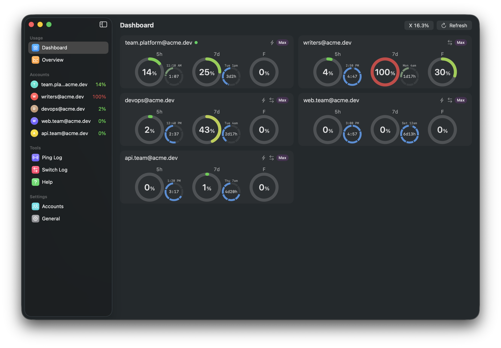
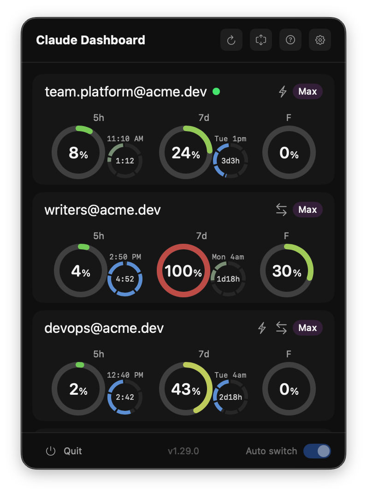
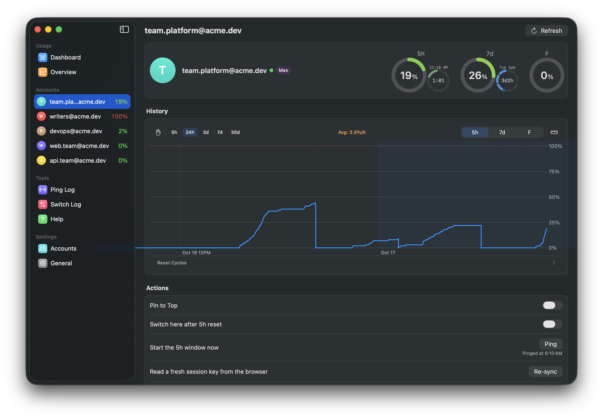
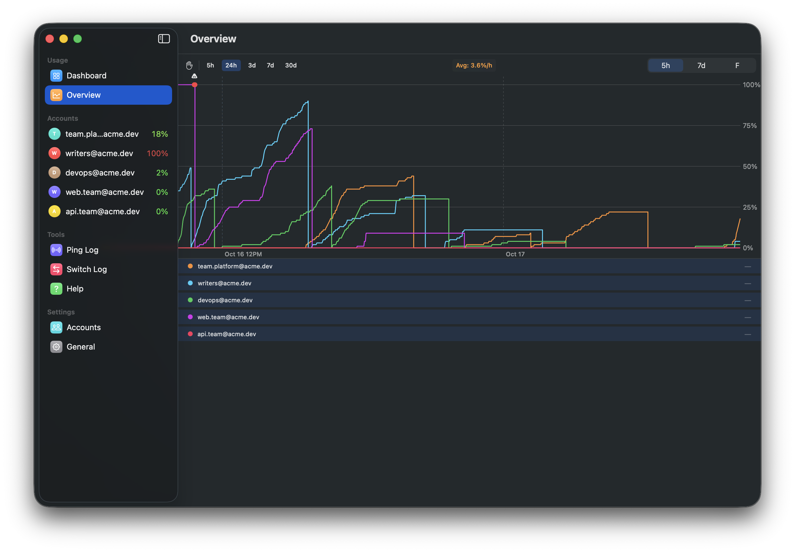
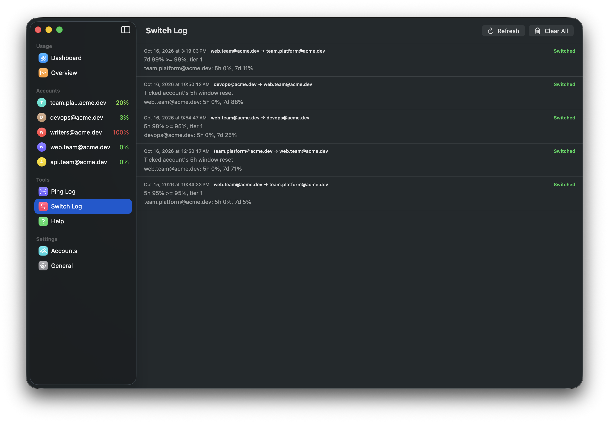
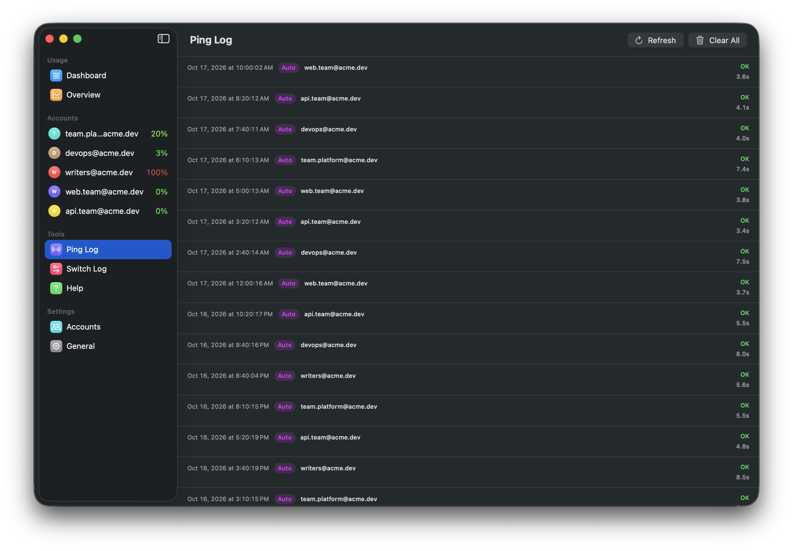
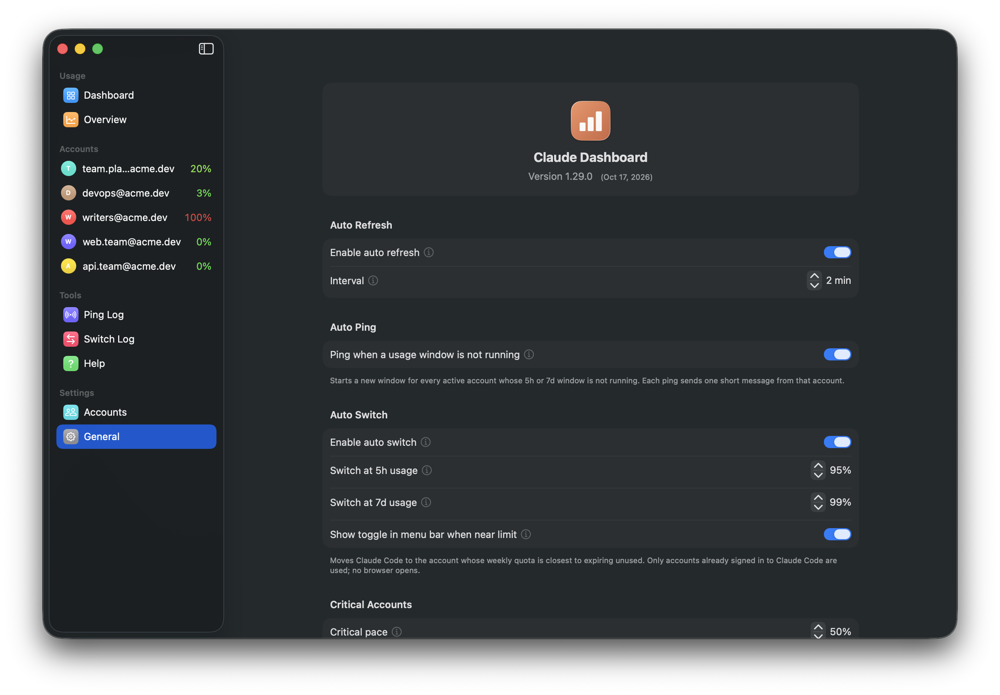
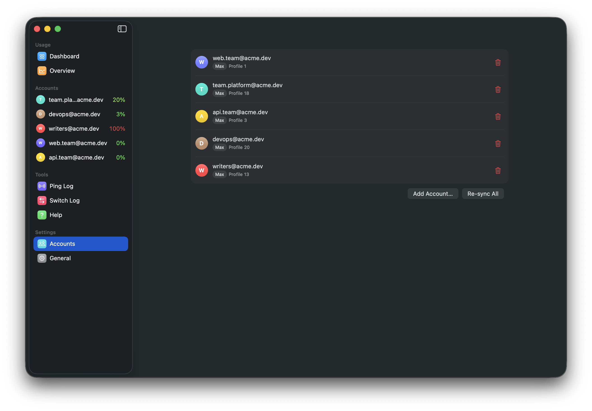
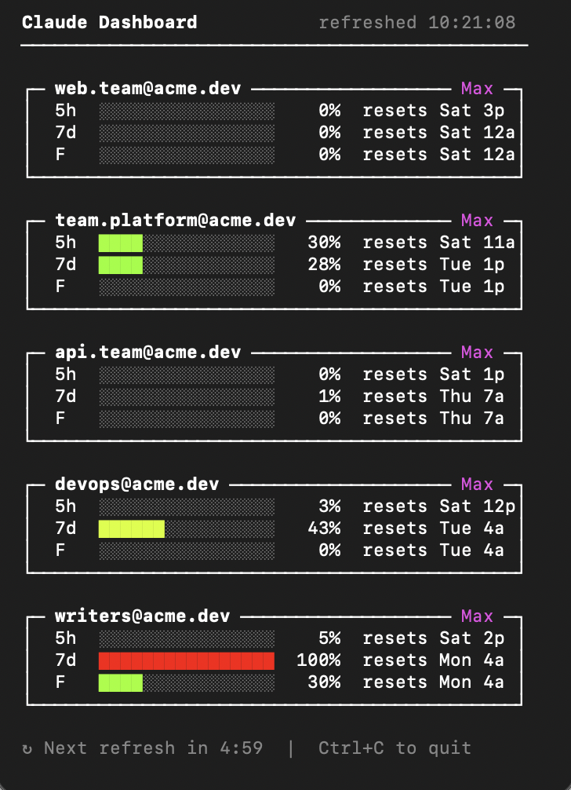

# Claude Dashboard

A macOS menu bar app that monitors Claude.ai usage across multiple accounts in real time, and moves Claude Code to the account with quota to spare.



## Features

### Usage at a glance

- **Multi-account monitoring**: every Claude.ai account you are signed in to, side by side
- **Menu bar label**: 5h usage and the time left until reset for your pinned account (or the top account)
- **Ring gauges** for the 5-hour window, the 7-day window and, when your plan has one, the weekly Fable window. A small countdown ring next to each shows the time until it resets
- **Burn-rate sorting**: accounts that will hit 100% soonest come first
- **Plan detection**: Pro, Max 5x, Max 20x, or Max when the tier is unknown
- **Color-coded**: green when there is plenty left, red when almost out

### Charts

- **History chart** on each account page: 5h, 7d or Fable window over the last 5h, 24h, 3d, 7d or 30d
- Pan and zoom, filter by reset cycle, and measure the change between two points
- **Overview**: every account on one chart; click a legend entry to show or hide it

### Claude Code account switching

- **One-click Switch**: point Claude Code at another account. The first switch for an account signs in once through that account's own browser profile; after that it is instant, with no browser, for about 30 days
- **Auto Switch** (on by default): when the active account reaches 95% of 5h or 99% of 7d, Claude Code moves to the account whose weekly quota is closest to going unused
- **Critical accounts**: a flame marks an account whose weekly quota will expire unused even at a steady pace, and Auto Switch uses it first
- **Home after reset**: tick an account to bring Claude Code back to it each time its 5h limit resets
- **Switch Log**: every switch and failed attempt, with the reason

### Ping

- **Ping** starts an account's 5h and 7d windows now (by sending one short message), so they reset sooner
- **Auto Ping** (off by default) pings every active account whose window is not running
- **Ping Log**: the latest 500 pings and their results

### And

- Reads sessions from **Chrome, Chrome Dev, Arc, Brave or Edge**, or takes a pasted session key
- Auto refresh (every 1 to 60 minutes) and a daily auto-update from GitHub releases
- **Zero dependencies**: pure native Swift (SwiftUI, AppKit, Combine)

## Screenshots

| Menu Bar Popover | Account Page |
|:---:|:---:|
|  |  |

| Overview Chart | Switch Log |
|:---:|:---:|
|  |  |

| Ping Log | Settings |
|:---:|:---:|
|  |  |

## Installation

### Homebrew (recommended)

```bash
# Menu bar app
brew install --cask haiz/claude-dashboard/claude-dashboard

# Terminal CLI
brew install haiz/claude-dashboard/claude-dashboard-cli
```

### One-liner

```bash
curl -fsSL https://raw.githubusercontent.com/haiz/claude-dashboard/main/install.sh | bash
```

### Manual Download

1. Go to the [latest release](https://github.com/haiz/claude-dashboard/releases/latest)
2. Download `ClaudeDashboard.app.zip`
3. Extract and move `ClaudeDashboard.app` to `/Applications`
4. Right-click the app and select **Open** (first time only, since the app is unsigned)

### First run

1. Sign in to claude.ai in Chrome, Chrome Dev, Arc, Brave or Edge, one browser profile per account.
2. Open **Settings > Accounts** and click **Add Account...**
3. Pick your browser, check the accounts it finds, then click **Add Selected**.
4. When macOS asks for Keychain access, choose **Always Allow**. The app needs it to read the browser's cookies.

No browser session? Click **Paste a session key instead** and paste the account's claude.ai `sessionKey` cookie. The in-app **Help** page (Tools > Help) covers every feature.



### Linux

```bash
curl -fsSL https://raw.githubusercontent.com/haiz/claude-dashboard/main/install.sh | bash
```

The same one-liner installs the terminal CLI into `~/.local/bin` on Linux
(x86_64 and aarch64). `jq` is required; install it with `apt install jq` or
`dnf install jq`. Browser scanning (`sync`) additionally needs `secret-tool`
from `libsecret-tools`.

On GNOME 45, 46, or 47, a GNOME Shell panel indicator is also available: an
icon in the top bar showing your highest utilization across accounts, with a
popup listing each account's email, plan, and ring gauges for the 5h, 7d, and
(where present) Fable windows, the same countdown-ring and burn-rate-animal
gauges as the macOS menu bar popover. It is a panel indicator and popup only;
the fuller macOS surfaces (the dashboard window, historical charts, Claude
Code switching, Ping, the logs, Help, the setup wizard, and auto-update)
remain macOS-only. Install and enable it with:

```bash
apps/linux/gnome-extension/install.sh
gnome-extensions enable claude-dashboard@haiz.github.io
```

`install.sh` symlinks the extension source into
`~/.local/share/gnome-shell/extensions/` and compiles its settings schema. On
Wayland, a newly installed extension is only picked up by the Shell after you
log out and back in, since the session can't be restarted in place. The
extension drives the existing `claude-dashboard-helper` binary (the same one
the CLI uses), so account and `sync` state is shared between the extension
and the CLI.

Two GSettings keys under `org.gnome.shell.extensions.claude-dashboard`
configure it. Edit them from the extension's own Preferences dialog (the
gear icon in the popup, or `gnome-extensions prefs claude-dashboard@haiz.github.io`),
or with `gsettings`:

- `refresh-interval`: seconds between helper calls, default 120. Takes
  effect immediately; no need to disable and re-enable the extension.
- `helper-path`: an escape hatch, blank by default. The extension looks for
  `claude-dashboard-helper` on `PATH` and then at `~/.local/bin/claude-dashboard-helper`
  (where the one-liner above installs it); set this key explicitly only if
  the helper lives somewhere neither of those finds it, which can happen in
  a Wayland/systemd user session that doesn't inherit a login shell's `PATH`.

Known limitations on Linux:

- `sync`'s browser scan is accepted for Chrome only, and only for a native
  install with a single profile on x86_64. Brave and Edge run the same code
  through different profile paths and keyring names and have never been run
  against a real cookie database; the same holds for multiple profiles in one
  browser and for Flatpak/snap installs.
- Chromium's v12 (secret-portal) cookies need a secret-service backend
  reachable through `secret-tool`. A profile is skipped only when none of the
  tried app-id candidates yield a usable portal secret.

### Windows

In PowerShell (no admin needed):

```powershell
irm https://raw.githubusercontent.com/haiz/claude-dashboard/main/install.ps1 | iex
```

This installs the latest per-user `ClaudeDashboard-x64.msi` into
`%LOCALAPPDATA%\Programs\ClaudeDashboard`, starts the app in the system tray,
and unpacks the browser extension to `%LOCALAPPDATA%\claude-dashboard\extension`.
Re-run it to upgrade (the app also updates itself). To use the extension, open
**Settings > Accounts > Add Account**: the **Browser extension** tab lists every
Chrome, Edge and Brave profile with an **Install** button that opens the
extension's page in that profile (until the store listing is live it opens a
setup page there instead, which walks through **Developer mode** and **Load
unpacked**). Uninstall from **Settings > Apps**;
your accounts and settings are kept.

## Terminal CLI

A terminal dashboard is available on macOS and Linux. On macOS, install it with the `claude-dashboard-cli` Homebrew formula; it reuses the menu bar app's account storage, so after `sync` every account shows up in both. On Linux, install it with the one-liner above; it shares account storage with the GNOME panel extension.



### Quick Start

```bash
# 1. Install
brew install haiz/claude-dashboard/claude-dashboard-cli                                   # macOS
curl -fsSL https://raw.githubusercontent.com/haiz/claude-dashboard/main/install.sh | bash  # Linux

# 2. Scan installed browsers for Claude sessions and save accounts
claude-dashboard-cli sync

# 3. Launch the live dashboard
claude-dashboard-cli
```

`sync` opens the cookie database of every installed supported browser (Chrome, Chrome Dev on macOS, Arc, Brave, Edge), validates each session against the Claude.ai API, detects the plan (Pro or Max), and saves the accounts: on macOS to `~/Library/Preferences/com.claude-dashboard.app.plist` (shared with the menu bar app), on Linux to `~/.config/claude-dashboard/accounts.json` (or `$XDG_CONFIG_HOME/claude-dashboard/accounts.json` if that variable is set).

### Commands

| Command | Description |
|---------|-------------|
| `claude-dashboard-cli` | Launch the live dashboard (default: refresh every 5 min) |
| `claude-dashboard-cli sync` | Re-scan the installed browsers and add any new accounts |
| `claude-dashboard-cli --once` | Render the dashboard once and exit (useful for scripts) |
| `claude-dashboard-cli --interval <sec>` | Change the refresh interval (e.g. `--interval 60`) |
| `claude-dashboard-cli --no-color` | Disable ANSI colors |
| `claude-dashboard-cli --version` | Print the CLI version |
| `claude-dashboard-cli --help` | Show help |

### What each row means

Each account card shows up to three usage bars:

- **5h**: 5-hour rolling window utilization
- **7d**: 7-day rolling window utilization
- **F**: Fable weekly window utilization (only when the account has one)

The `resets` column shows when each window resets (local time). Bars go green, yellow, then red as utilization approaches 100%. A card whose session has expired shows a status line in place of the bars.

### Tips

- Re-run `claude-dashboard-cli sync` whenever you log into a new Claude account in a supported browser, or after a session expires.
- **macOS:** to manage accounts (add, delete, re-sync), open the menu bar app; both share the same storage.
- **Linux:** on GNOME 45+, the panel extension (see the Linux install section above) shares the same account storage and has its own Sync button. Otherwise, re-run `claude-dashboard-cli sync` to rescan browsers, or, when no browser is available, add or repair one account by piping a session key to `claude-dashboard-helper add-key` on stdin, e.g. `echo "$SESSION_KEY" | claude-dashboard-helper add-key`.
- Press `Ctrl+C` to quit the live dashboard.

## Requirements

- **macOS** 13.0 (Ventura) or later, for the menu bar app and the CLI
- **Linux** x86_64 or aarch64, for the CLI. The binaries are statically
  linked, so there is no distribution or glibc floor. The GNOME panel
  extension additionally requires GNOME Shell 45 or later.
- **Windows** 10 or 11, x64 (ARM64 runs the x64 build under emulation), for
  the tray app
- One of Google Chrome, Arc, Brave, or Microsoft Edge (for automatic session key
  extraction); on macOS, Google Chrome Dev also works
- **Claude Code** (optional), for account switching

## How It Works

1. Reads Claude.ai session cookies from a supported browser's encrypted cookie database (Chrome, Chrome Dev, Arc, Brave, or Edge)
2. Encrypts session keys with AES-GCM (key derived from the machine's identity: the hardware UUID on macOS, `/etc/machine-id` on Linux) and stores them, on macOS in the app's preferences, on Linux in `~/.config/claude-dashboard/accounts.json`
3. Fetches usage data from Claude.ai's API
4. Displays real-time utilization with burn-rate-based sorting
5. To switch Claude Code, keeps a copy of each account's Claude Code login in the Keychain and swaps the active one in `~/.claude`

> **Note:** The app requires access to the browser's cookie database and Keychain (that browser's Safe Storage password). App Sandbox is disabled for this reason. On Linux, the equivalent dependency is a secret-service backend reachable through `secret-tool` (e.g. GNOME Keyring); there is no Keychain or App Sandbox on that platform.

## Repository Layout

```
apps/macos/       SwiftUI menu bar app, tests, and the Swift helper binary
apps/linux/       Rust workspace: the shared core plus the Linux helper binary.
                  Drives the same bash CLI. apps/linux/gnome-extension/ is a
                  GNOME Shell panel indicator built on the same helper.
apps/windows/     Rust workspace for Windows: the Slint tray app, the
                  native-messaging bridge, and the browser extension
contract/         Behaviour shared across platforms: docs plus executable cases
cli/              claude-dashboard-cli, the bash terminal dashboard
scripts/          release, version sync
.github/workflows/ release-linux.yml and release-windows.yml
Formula/ Casks/   Homebrew tap (must stay at the repo root)
install.sh        one-liner installer (published URL, must stay at the repo root)
install.ps1       Windows one-liner installer (published URL, must stay at the repo root)
```

## Build from Source

Requires Xcode 16.3+ and [XcodeGen](https://github.com/yonaskolb/XcodeGen).

```bash
# Install XcodeGen (if needed)
brew install xcodegen

# Clone and build
git clone https://github.com/haiz/claude-dashboard.git
cd claude-dashboard
(cd apps/macos && xcodegen generate)
xcodebuild -project apps/macos/ClaudeDashboard.xcodeproj -scheme ClaudeDashboard -configuration Release build

# The built app is in DerivedData
open ~/Library/Developer/Xcode/DerivedData/ClaudeDashboard-*/Build/Products/Release/ClaudeDashboard.app
```

## License

MIT
